  

  
  
  

Grade 10 student at the **Gifted Technical Secondary School (Tuwaiq Academy)**. I learn by building, breaking and documenting: from compiling a Linux system by hand to systems-security research.

### What I'm working on

- 🐧 **Linux From Scratch 13.0 (systemd)**: compiled from source on my HP 255R G10, dual-booting with Arch. Build and boot troubleshooting log → [linux-from-scratch-hp255r-g10](https://github.com/Malminhli/linux-from-scratch-hp255r-g10)
- 🛡️ **REVENANT** (formerly MORPH-RT): systems-security research prototype in C11 for Linux user space. I designed the architecture; the implementation was AI-assisted. Passed the online evaluation stage of the Ibdaa Olympiad for Scientific Research. *Source not public.*
- 🐞 **Bug bounty**: semi-finalist in Tuwaiq Academy's Junior Bug Bounty Challenge. Practising on PortSwigger Web Security Academy and Root Me.

### Toolbox

  
  
  
  
  
  
  
  
  
  

### Other projects

| Project | What it is |
|---|---|
| [pocket-focus](https://github.com/Malminhli/pocket-focus) | A tiny bilingual Pomodoro focus timer for the browser |
| [space-quest-terminal-rpg](https://github.com/Malminhli/space-quest-terminal-rpg) | Terminal RPG in JavaScript |
| [smartmem-web-app](https://github.com/Malminhli/smartmem-web-app) | TypeScript web app |
| [machine-learning-nlp-lab-exercises](https://github.com/Malminhli/machine-learning-nlp-lab-exercises) | Machine learning and NLP lab exercises in Python |

Building systems from scratch. Securing them with AI.

